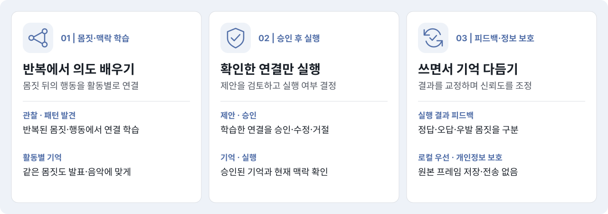
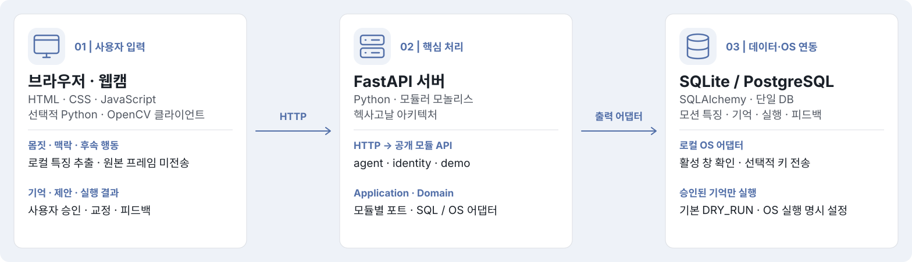
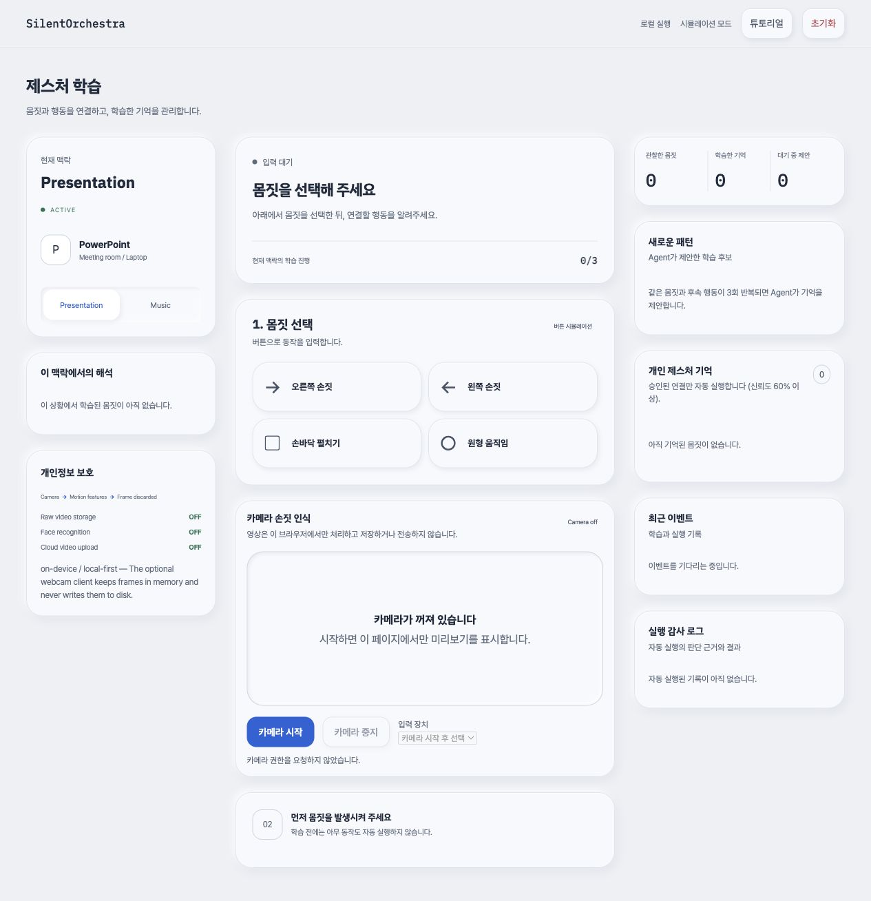
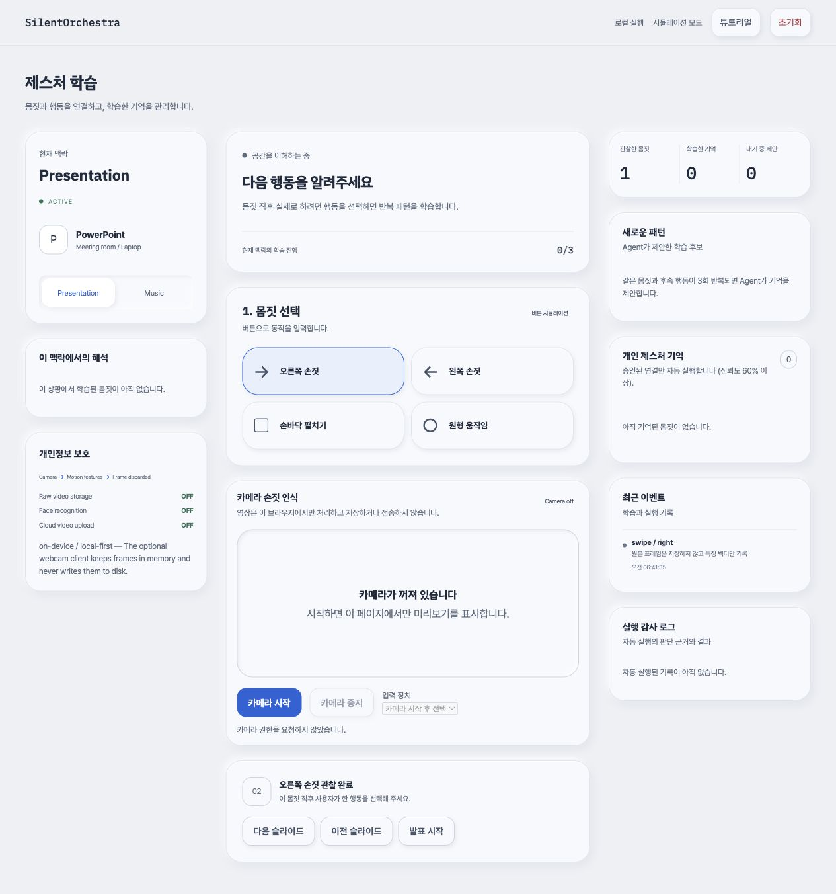
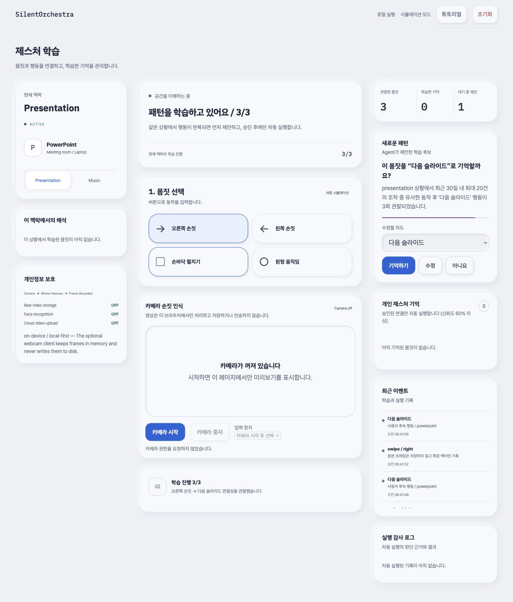
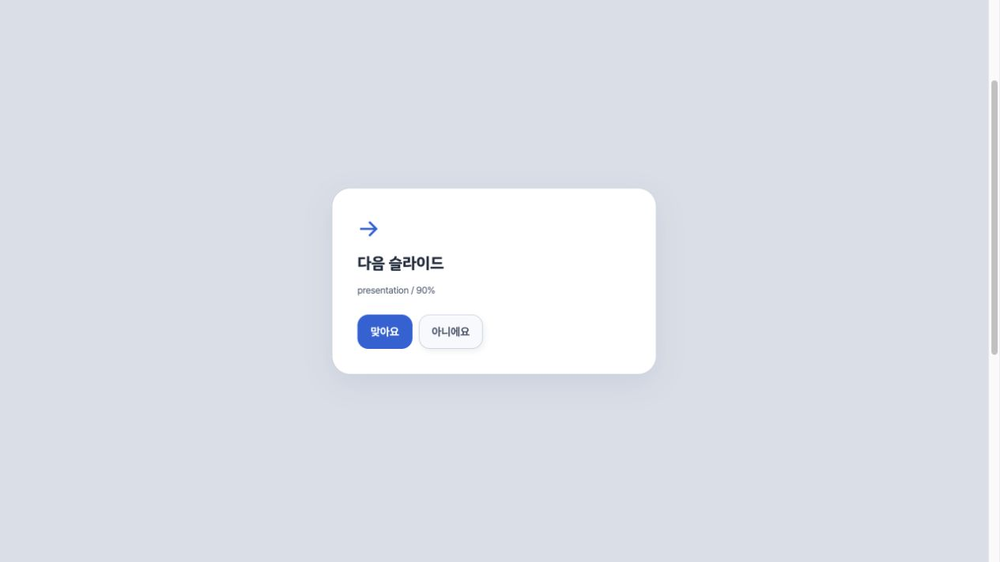
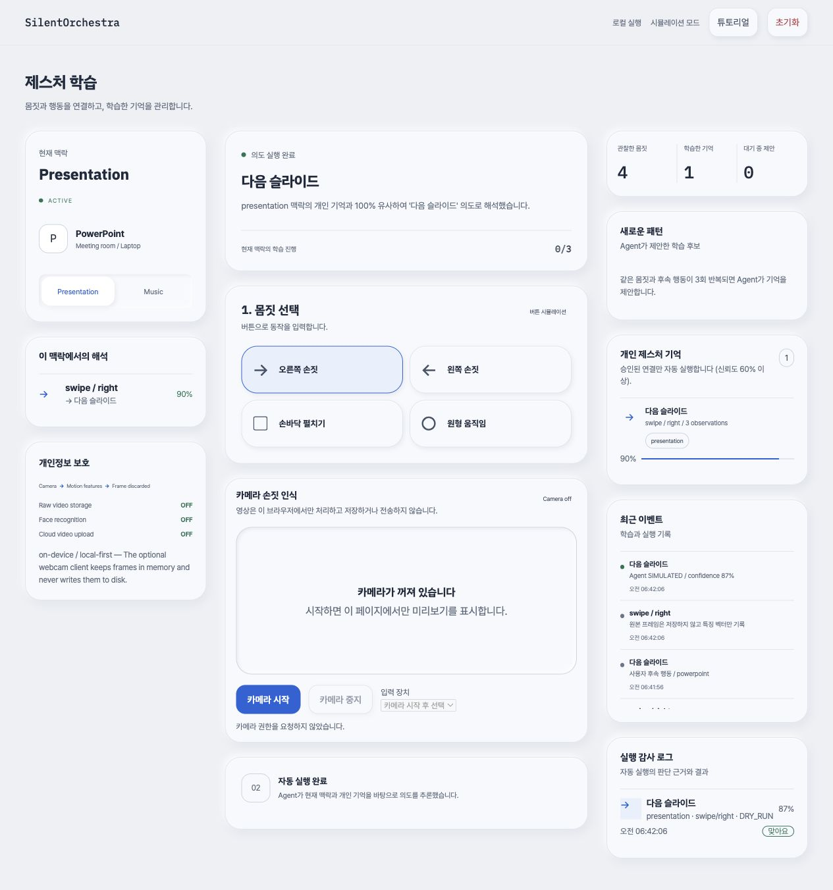

# SilentOrchestra 2.0

몸짓 뒤의 행동을 활동별로 학습하고, 사용자가 승인한 연결만 실행하는 로컬 우선 Agent입니다.

[시작하기](#시작하기) · [사용 방법](#사용-방법) · [테스트](#테스트) · [관련 문서](#관련-문서)

## 핵심 기능



## 아키텍처

단일 FastAPI 프로세스와 DB에 `identity`, `agent`, `demo` 모듈을 배치하는 **모듈러 모놀리스 + 헥사고날 아키텍처**입니다. HTTP 입력은 공개 모듈 API와 유스케이스를 거쳐 도메인으로 전달됩니다. 각 모듈의 출력 포트를 SQL·OS 어댑터가 구현하고 `bootstrap.py`가 연결합니다.



구현 구조는 [구현 계획](plan.md#구현-구조), 기능 범위와 동작 계약은 [요구사항](spec.md)을 참고합니다.

## 기술 스택

| 영역 | 구성 | 기준 파일 |
| --- | --- | --- |
| 백엔드 | Python · FastAPI · SQLAlchemy · SQLite(기본) | [pyproject.toml](backend/pyproject.toml) |
| 프론트엔드 | HTML · CSS · JavaScript | [frontend](frontend/) |
| 선택 입력·실행 | OpenCV · NumPy · PyAutoGUI | [웹캠](#웹캠) · [OS 실행](#os-실행) |

## 주요 화면

로컬 데모의 버튼 시뮬레이션으로 캡처한 화면입니다. 실행 결과는 실제 앱을 조작하지 않는 `DRY_RUN` 기준입니다.

### 제스처 워크벤치

현재 활동 맥락, 몸짓 입력, 카메라 상태와 학습한 기억을 한 화면에서 확인합니다.



<details>
<summary>몸짓과 행동 연결</summary>

몸짓을 선택한 뒤 의도한 행동을 알려줍니다. 같은 맥락에서 연결을 반복하면 패턴을 학습합니다.



</details>

<details>
<summary>학습 제안과 승인</summary>

같은 연결이 3회 관찰되면 기억을 제안합니다. 사용자는 제안을 승인하거나 행동을 수정·거절할 수 있습니다.



</details>

<details>
<summary>실행 결과와 피드백</summary>

승인한 몸짓을 다시 입력하면 해석한 행동과 신뢰도를 표시하고, 실행 결과에 대한 피드백을 받습니다.



</details>

<details>
<summary>개인 기억과 실행 감사 로그</summary>

승인한 연결과 신뢰도, 최근 이벤트, 실행 모드 및 피드백 기록을 확인합니다.



</details>

## 시작하기

Python 3.11 이상이 필요합니다. 아래 명령은 모두 저장소 루트에서 실행합니다.

```bash
python3 -m venv .venv
source .venv/bin/activate          # Windows: .venv\Scripts\Activate.ps1
python -m pip install -e ./backend
python run_demo.py
```

브라우저에서 <http://127.0.0.1:8000>을 엽니다.

## 사용 방법

웹 UI의 기본 실행은 실제 앱을 조작하지 않는 `DRY_RUN`입니다.

1. 활동 맥락을 선택하고 몸짓과 후속 행동을 반복 입력합니다.
2. 제안이 생성되면 내용을 확인하고 승인합니다.
3. 같은 맥락에서 몸짓을 다시 입력해 실행 결과를 확인합니다.
4. 실행 결과에 피드백을 남겨 기억을 보정합니다.

API 요청·응답은 실행 서버의 [Swagger UI](http://127.0.0.1:8000/docs)를 참고합니다.

## 환경 설정

기본 설정으로 로컬 데모를 시작할 수 있습니다. 값을 바꾸려면 루트에 `.env`를 만들고 [.env.example](.env.example)을 참고합니다. 기본값과 로딩 규칙은 [config.py](backend/src/silent_orchestra/config.py)에서 관리합니다.

- `SO_DATABASE_URL`: DB 연결 주소.
- `SO_DEMO_MODE`: `demo-user` 초기화 API 허용 여부. 데모 외 환경에서는 `false`로 설정합니다.
- `SO_ENABLE_OS_ACTIONS`: 실제 OS 실행 여부. 기본값은 `false`입니다.
- `SO_REQUIRE_ACTIVE_WINDOW`: 실행 대상의 활성 창 검사 여부. 기본값은 `true`입니다.

설정 변경 후 서버를 재시작합니다. 선택 기능은 아래 절차로 활성화합니다.

### 웹캠

```bash
python -m pip install -e "./backend[camera]"
# 서버 실행 후 별도 터미널에서 Windows 실제 키 관측
python backend/scripts/webcam_gesture_client.py --learn
# 첫 프레임 점검
python backend/scripts/webcam_gesture_client.py --check-camera --camera 0
# Windows 관측을 사용할 수 없는 경우 명시적 라벨 입력
python backend/scripts/webcam_gesture_client.py --input-mode labels --activity presentation --learn
```

- 기본 옵션: `--input-mode observe --activity auto`. 원래 키 입력은 차단하지 않으며 수정키 조합은 관측에서 제외합니다.
- PowerPoint Slide Show: Right/PageDown/N/Space는 다음, Left/PageUp/P는 이전, Escape는 종료. 편집 화면은 제외합니다.
- Spotify/VLC/iTunes/Music: Media Next/Previous/PlayPause만 관측하며 일반 Space는 제외합니다.
- 라벨 모드: N/B는 다음·이전, music의 Space는 재생·일시정지. 실제 앱 조작은 관측·수행하지 않습니다.
- 장치 진단: `--camera INDEX`, `--camera-backend dshow|msmf|default`.

### OS 실행

```bash
python -m pip install pyautogui
export SO_ENABLE_OS_ACTIONS=true  # PowerShell: $env:SO_ENABLE_OS_ACTIONS = "true"
python run_demo.py
```

설정은 서버 시작 시 읽습니다. `SO_REQUIRE_ACTIVE_WINDOW=true`가 기본입니다. macOS는 접근성 권한이 필요하며 Windows는 활성 창 제목으로 판정합니다. Linux는 활성 창 확인을 지원하지 않습니다. OS 실행을 끄려면 환경 변수를 false로 바꾸고 서버를 재시작합니다.

## 테스트

시작하기에서 만든 Python 가상 환경과 Node.js가 필요합니다. 저장소 루트에서 실행합니다.

```bash
python -m pip install -e "./backend[dev]"
python -m pytest backend/tests -q
node --test frontend/tests/app.test.cjs
python backend/scripts/validate_sqlite.py --schema backend/sql/schema.sql --seed backend/sql/seed.sql --queries backend/sql/queries.sql --tests backend/sql/tests.sql --report /tmp/sqlite-validation.json
```

CI의 Python·SQL 검사는 [.github/workflows/ci.yml](.github/workflows/ci.yml)에서 관리합니다. 검증 범위와 실제 장비 점검은 [검증 전략](plan.md#검증-전략)과 [남은 과제](plan.md#남은-과제)를 참고합니다.

## 관련 문서

| 문서 | 내용 |
| --- | --- |
| [요구사항](spec.md) | 기능 범위·학습 및 실행 계약·완료 기준 |
| [구현 계획](plan.md) | 코드 위치·의존성·검증 전략·실제 장비 점검 |
| [디자인 기준](docs/design.md) | UI·접근성·다이어그램 표현 규칙 |
| [작업 지침](AGENTS.md) | 작업 순서·문서 관리 규칙 |
