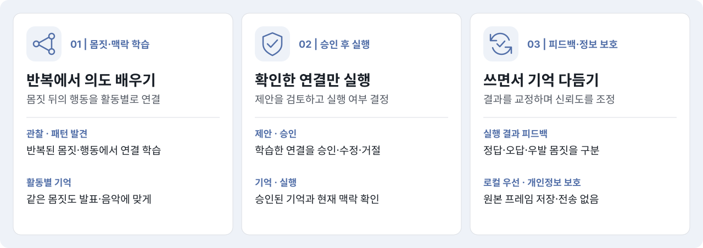
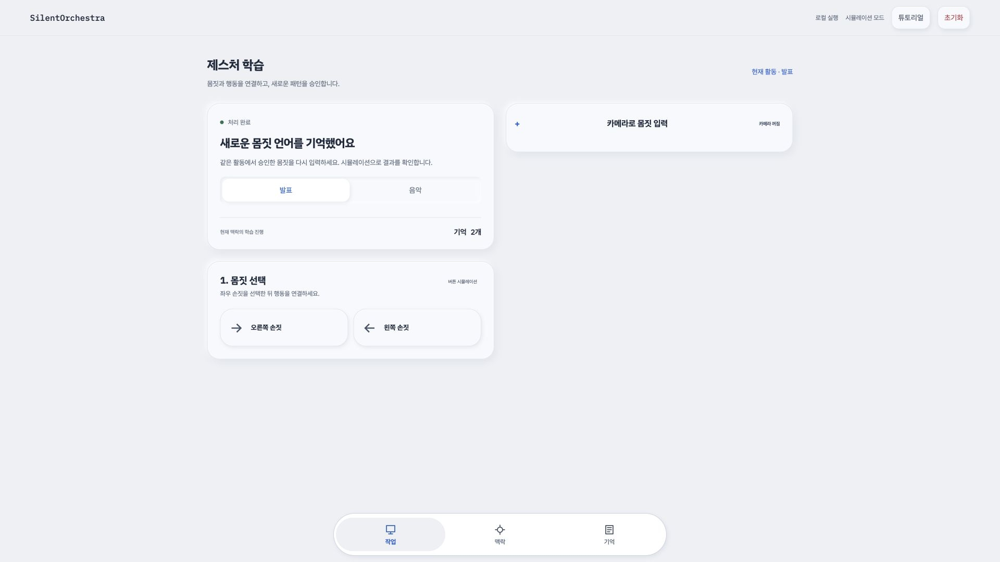
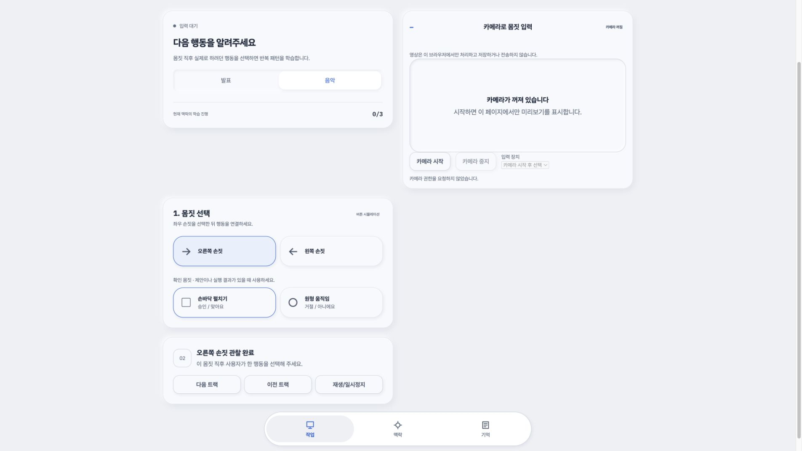
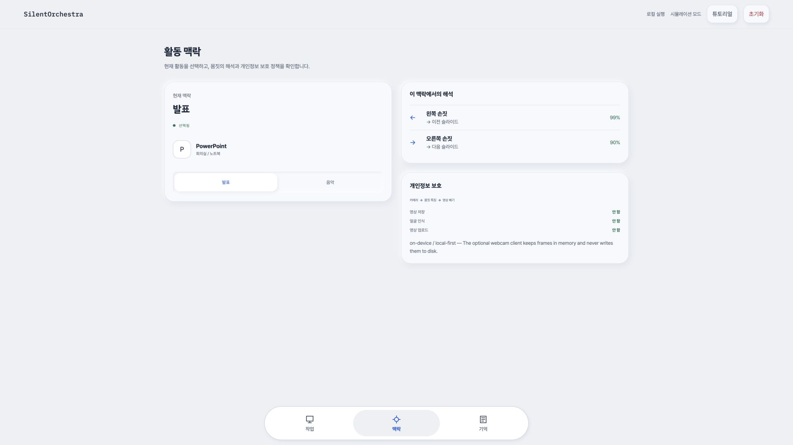
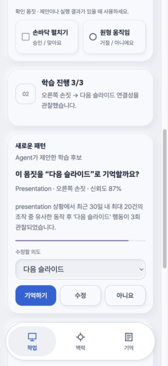
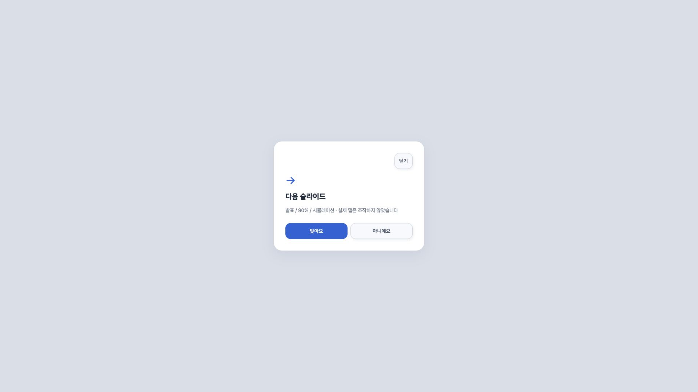
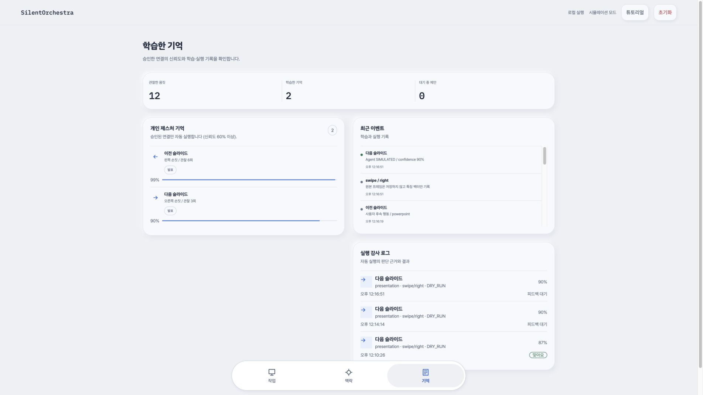
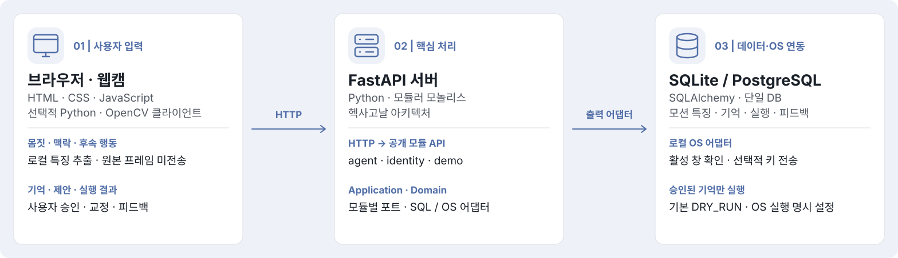

# SilentOrchestra 2.0

## 소개

몸짓 뒤의 행동을 활동별로 학습하고 승인된 연결만 실행하는 로컬 우선 Agent입니다.

[시작하기](#시작하기) · [사용 방법](#사용-방법) · [테스트](#테스트) · [관련 문서](#관련-문서)

### 핵심 기능



### 주요 화면

| 제스처 워크벤치 | 몸짓과 행동 연결 | 활동 맥락 | 학습 제안·승인 | 실행 결과·피드백 | 학습한 기억 |
| :-: | :-: | :-: | :-: | :-: | :-: |
| [](docs/assets/screenshots/01_workbench.png) | [](docs/assets/screenshots/02_teaching.png) | [](docs/assets/screenshots/03_context.png) | [](docs/assets/screenshots/04_suggestion.png) | [](docs/assets/screenshots/05_execution-feedback.png) | [](docs/assets/screenshots/06_memory-audit.png) |
| 활동·몸짓 선택 | 의도한 행동 연결 | 활동별 맥락 확인 | 제안 승인·수정·거절 | 실행 결과 보정 | 승인된 연결·신뢰도 확인 |

## 기술 스택

| 영역 | 구성 | 기준 파일 |
| --- | --- | --- |
| 백엔드 | Python · FastAPI · SQLAlchemy · SQLite(기본) | [pyproject.toml](backend/pyproject.toml) |
| 프론트엔드 | HTML · CSS · JavaScript | [frontend](frontend) |
| 선택 입력·실행 | OpenCV · NumPy · PyAutoGUI | [웹캠](#웹캠) · [OS 실행](#os-실행) |

### 아키텍처

단일 FastAPI 프로세스와 DB에 `identity`, `agent`, `demo` 모듈을 두는 **모듈러 모놀리스 + 헥사고날 아키텍처**입니다. HTTP 입력은 공개 모듈 API와 유스케이스를 거쳐 도메인으로 전달되고, SQL·OS 어댑터는 `bootstrap.py`에서 출력 포트에 연결합니다.



구조: [기술 구조](docs/03-tech/01-architecture.md#소스-구조) · 기능 계약: [요구사항](docs/01-func/01-requirements.md)

## 시작하기

Python 3.11+ 필요(저장소 루트 기준).

```bash
python3 -m venv .venv
source .venv/bin/activate          # Windows: .venv\Scripts\Activate.ps1
python -m pip install -e ./backend
python run_demo.py                 # http://127.0.0.1:8000
```

### 환경 설정

기본값으로 바로 실행되며, 변경 시 루트 `.env`([.env.example](.env.example), [config.py](backend/src/silent_orchestra/config.py))를 수정한 뒤 재시작합니다.

- `SO_DATABASE_URL`: DB 연결 주소
- `SO_DEMO_MODE`: `demo-user` 초기화 API 허용 여부(비데모 환경은 `false`)
- `SO_ENABLE_OS_ACTIONS`: 실제 OS 실행 여부(기본 `false`)
- `SO_REQUIRE_ACTIVE_WINDOW`: 실행 대상 활성 창 검사 여부(기본 `true`)

#### 웹캠

```bash
python -m pip install -e "./backend[camera]"
python backend/scripts/webcam_gesture_client.py --learn                                      # Windows 키 관측(서버 실행 후)
python backend/scripts/webcam_gesture_client.py --check-camera --camera 0                    # 첫 프레임 점검
python backend/scripts/webcam_gesture_client.py --input-mode labels --activity presentation --learn  # 비관측 라벨 입력
```

- 기본(`--input-mode observe --activity auto`): 원래 키 입력을 통과시키며 수정키 조합은 제외합니다.
- PowerPoint Slide Show(편집 화면 제외): Right/PageDown/N/Space=다음, Left/PageUp/P=이전, Escape=종료.
- Spotify/VLC/iTunes/Music: Media Next/Previous/PlayPause만 관측(일반 Space 제외).
- 라벨 모드: N/B=다음·이전, music의 Space=재생·일시정지(실제 앱 미조작). 진단: `--camera INDEX`, `--camera-backend dshow|msmf|default`.

#### OS 실행

```bash
python -m pip install pyautogui
export SO_ENABLE_OS_ACTIONS=true   # PowerShell: $env:SO_ENABLE_OS_ACTIONS="true"
python run_demo.py
```

기본 `SO_REQUIRE_ACTIVE_WINDOW=true`로 동작합니다(macOS: 접근성 권한 필요, Windows: 활성 창 제목 판정, Linux: 미지원). 해제 시 `false`로 바꾸고 재시작합니다.

## 사용 방법

기본 실행 모드는 앱을 조작하지 않는 `DRY_RUN`입니다.

1. 작업 화면에서 활동(`presentation`·`music`) 선택 → 좌우 손짓과 행동 연결 → 같은 몸짓 재입력으로 3회 학습(`open_palm:none`=승인·정답, `circle:clockwise`=거절·오답 전용).
2. 생성된 제안을 확인·승인합니다.
3. 같은 맥락에서 몸짓을 재입력해 실행 결과를 확인하고 피드백으로 기억을 보정합니다.

API 문서: [Scalar](http://127.0.0.1:8000/docs) · 수동 호출: Bruno([backend/bruno](backend/bruno), Local 환경 또는 `/openapi.json` 가져오기)

## 테스트

Python 가상 환경과 Node.js 필요(루트 실행, CI: [.github/workflows/ci.yml](.github/workflows/ci.yml)).

```bash
python -m pip install -e "./backend[dev]"
python -m pytest backend/tests -q
node --test frontend/tests/*.test.cjs
python backend/scripts/validate_sqlite.py --schema backend/sql/schema.sql --seed backend/sql/seed.sql --queries backend/sql/queries.sql --tests backend/sql/tests.sql --report /tmp/sqlite-validation.json
```

검증 범위·장비 점검: [검증 전략](docs/04-test/01-verification.md#검증-전략) · [남은 작업](docs/03-tech/01-architecture.md#남은-작업과-리스크)

## 관련 문서

- [작업 지침](AGENTS.md): 작업 순서·문서 관리.

### 문서 분류 기준

<!-- doc-standard:start — doc-standard에서 동기화한다. 이 구간은 직접 고치지 않는다. -->
| 위치 | 담는 내용 |
| --- | --- |
| [`docs/01-func/`](docs/01-func/01-requirements.md) | 범위, 역할별 기능, 업무 정책, 완료 기준 |
| [`docs/02-uxui/`](docs/02-uxui/01-design.md) | 화면 배치·조작·디자인 기준·시각 자산 |
| [`docs/03-tech/`](docs/03-tech/README.md) | 아키텍처, 소스 구조, 데이터 모델, REST/IPC 계약 |
| [`docs/04-test/`](docs/04-test/01-verification.md) | 검증 방법, 판정 기준, 최신 판정과 증거 |
| `docs/` 루트·주제 폴더 | 비명세 자료(과제 안내, 보고서, 발표, 협업 규칙, 자료 수집 기록) |
| 코드 저장소 루트 README | 로컬 설치·실행·테스트 명령 |

API 상세 원본은 OpenAPI·라우터·DTO이며 명세에는 원본 위치와 한계만 적는다. 배포 절차는 `05-ops/`(없으면 기술 명세)에 두고 로컬 실행 명령은 README를 링크한다.
<!-- doc-standard:end -->
